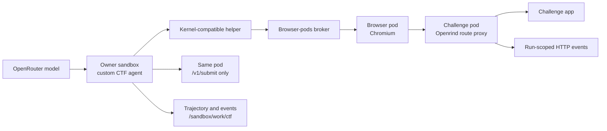

# Openrind CTF Runtime

This package runs browser CTF challenges from any tasks directory the user
selects. It bundles no challenge tasks. Each OpenShell challenge sandbox runs
the task's own application. Openrind adds a narrow HTTP proxy, a run-scoped
event log, and a separate flag judge.

## Task Directories

A directory is a CTF challenge when it has at least one of these fingerprints:

- `challenge.json` or `task.toml`
- `flag.txt` or `flag` in the directory or in a `chall/` or `challenge/` subdir
- a `chall/` or `challenge/` subdir with server code (`server.py`, `app.py`,
  `run.py`, `main.py`, `index.py`, `api.py`, `server.js`, `app.js`, `index.js`,
  `main.js`, or `index.html`)

Metadata comes from the directory itself:

- `challenge.json`: `name`, `description`, `flag`, `internal_port` or
  `backendPort`, `category`, and optionally `entrypoint` and
  `workingDirectory` inside the challenge image.
- `task.toml`: `name`, `description`, and `web_service_port`.
- `DESCRIPTION.md`, `instruction.md`, or `README.md`: the task description.
- `REHOST.md`: `Flag:` and `Port:` lines.
- `flag.txt`: the judge flag, in the directory or in `chall/` / `challenge/`.

In Openrind Desktop, select the directory that contains the challenges. The
Desktop service scans it, registers each discovered task, and lists it in the
CTF sidebar. A run writes its evidence to `<tasks-dir>/ctf-traces/`:
`<id>-trajectory.json`, `<id>-agent-events.jsonl`, and
`<id>-challenge-events.jsonl`.

## Runtime Design



The browser opens the app at its site path. The proxy forwards the request
path, method, headers, and body to the app process. It does not implement the
task routes. The browser policy allows only the task's listed routes. It does
not allow `/v1/**`.

The owner can call `POST /v1/submit` and `GET /v1/events?run=<run-id>` with the
judge token. The challenge image reads the expected flag from its own
`/opt/openrind-ctf/task/flag.txt`. It does not send the flag to the owner
before a successful submission. The agent exports only challenge events that
the server recorded under the current run ID.

The custom agent uses the unchanged `agent-browser` Kernel provider. It records
model requests and failures, browser actions, observations, and judge results.
Model requests go directly to OpenRouter in this developer test.

**Independent Trace Architecture:**
The CTF agent **does not use w8-Haloop** for model traffic and does not emit OTLP
spans over the gateway. Instead, it writes all run evidence directly as local
JSON/JSONL files (`trajectory.json`, `events.jsonl`, `challenge-events.jsonl`)
into a local `ctf-traces/` directory within the user-selected tasks folder
(e.g. `<tasks-dir>/ctf-traces/`). Any browser screenshots or DOM artifacts
captured for CTF evaluation are stored locally inside this folder.

**Optional collector evidence:** when a collector URL and producer token are
configured (`OPENRIND_CTF_COLLECTOR_URL` or `HALOOP_COLLECTOR_URL`, or derived
from `HALOOP_GATEWAY_URL`, plus `W8_CAPTURE_PRODUCER_TOKEN` or
`HALOOP_CAPTURE_TOKEN`), the agent additionally posts run-level evidence
to the Haloop collector evidence API at the end of each run: `task.started`,
the trajectory and challenge-event log as content-addressed artifacts, and an
`outcome.observed` verdict from the challenge judge (emitted for failed and
stopped runs too). This path is best-effort: collector failures are logged and
never fail the run. Without that configuration the agent stays fully local.

## Challenge Images

`sandboxes/ctf-challenge/Dockerfile` builds one image per task directory. The
build context must contain the CTF runtime and the task directory. Two build
args select them:

```bash
docker build --pull=false -f sandboxes/ctf-challenge/Dockerfile \
  --build-arg TASK_DIR=<path-to-task-dir-inside-the-context> \
  -t openrind-ctf-<id>:e2e .
```

`RUNTIME_DIR` defaults to `openrind-desktop/packages/ctf-runtime` for a
repository-root context. The live runner stages its own context, so a task
directory outside this repository works there.

The image contract:

- The task directory must contain `flag.txt`. The build fails without it.
- The app entrypoint runs with the image's Python venv at
  `/opt/openrind-ctf/venv`. Flask is preinstalled. A `requirements.txt` at the
  task root or in `chall/` / `challenge/` is installed on top. A non-Python
  challenge needs its own image; the Desktop service generates a per-task
  Dockerfile for that case.
- A `challenge.json` in the task directory supplies the metadata that
  `bin/challenge.mjs` loads at container start (`entrypoint`,
  `workingDirectory`, `backendPort`). Without one, the runtime falls back to
  the `chall/server.py` convention on port 8080.

## Tests

Run the local Node tests from the repository root:

```bash
node --test openrind-desktop/packages/ctf-runtime/test/*.test.mjs
```

These tests use small synthetic fixtures. They cover task metadata
normalization, the proxy contract, run attribution, judge isolation, and
Harbor task generation. The proxy test uses a local HTTP server. It does not
execute a challenge app.

Build a synthetic challenge image and run the container smoke test:

```bash
pnpm --dir openrind-desktop/packages/ctf-runtime test:images
```

It stages a tiny fixture app in a temporary directory, builds the image
through the generic Dockerfile, starts it, checks the proxy, the run-scoped
event export, and the independent judge, and removes the test container. It
needs Docker, but it does not need OpenShell, a browser, or a model key. It is
not a model evaluation.

## Live OpenShell Run

Use Linux x64 with Docker. Follow [BUILD.md's Real Linux Browser Test](../../../BUILD.md#real-linux-browser-test)
for host dependencies and matching OpenShell binaries. The test creates a
temporary gateway, an owner, one challenge sandbox, and a Chromium sandbox. It
does not use a customer Desktop owner.

Build the browser images from the repository root:

```bash
docker build --pull=false \
  -f openrind-desktop/packages/browser-pods/test/live/Dockerfile.owner \
  -t openrind-browser-owner:e2e .

docker build --pull=false \
  -f sandboxes/browser-pod/Dockerfile \
  --build-arg CHROMIUM_VERSION=154.0.8037.92-1~deb12u1 \
  -t openrind-browser-pod:e2e sandboxes/browser-pod
```

Point the runner at a challenge directory. The runner builds the challenge
image from that directory itself:

```bash
node openrind-desktop/packages/browser-pods/test/live/openshell-e2e.mjs \
  --ctf --ctf-task-dir=<path-to-task-dir>
```

`OPENRIND_CTF_TASK_DIR=<path>` works instead of the flag. With `--ctf` and no
task directory, the runner prints a skip message and runs the standard browser
fixture instead.

Set `OPENROUTER_API_KEY` through the host environment. The default model is
`openai/gpt-4o-mini`. Set `OPENRIND_CTF_MODEL` to select another
JSON-schema-capable OpenRouter model. Use
`OPENRIND_CTF_REASONING_EFFORT=low` only when the selected model supports that
OpenRouter option.

The test checks that the sandbox serves the app page. It then runs the custom
agent in the owner, drives the app through the browser pod, and requires the
separate judge to accept the flag. A model can fail to solve a valid task. Do
not insert a flag or replace an agent action to make the run pass.

The runner writes private evidence to a temporary directory. It includes model
messages, task requests, browser observations, and submissions. Do not publish
the evidence unchanged.

## Source Map

```text
sandboxes/ctf-challenge/Dockerfile
  generic challenge-pod image built from a caller-supplied task directory
openrind-desktop/packages/ctf-runtime/src/tasks.mjs
  dynamic task registry and metadata normalization (no bundled tasks)
openrind-desktop/packages/ctf-runtime/src/challenge-server.mjs
  app proxy, judge endpoint, and per-run event records
openrind-desktop/packages/ctf-runtime/src/agent.mjs
  browser agent, model calls, and trajectory writer
openrind-desktop/packages/ctf-runtime/bin/challenge.mjs
  in-image challenge server; loads the baked challenge.json
openrind-desktop/packages/browser-pods/test/live/openshell-e2e.mjs
  live OpenShell setup and model-backed task evaluation (--ctf-task-dir)
```
